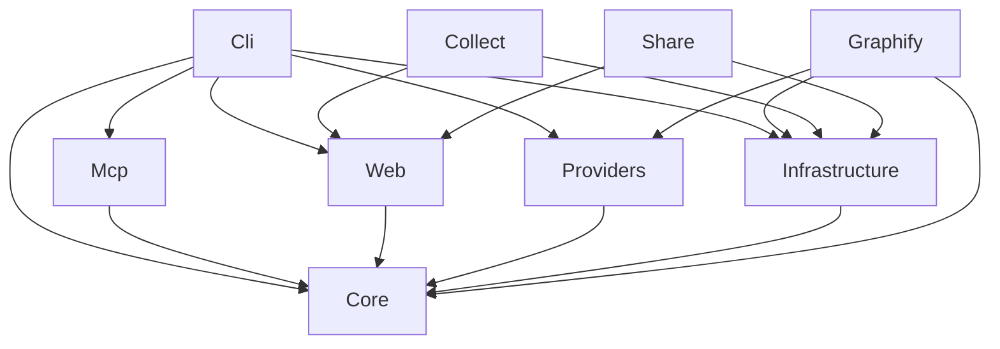

# Architecture

Harness separates domain contracts from storage, code providers and transports.
`Harness.Cli` composes these boundaries into the application. Feature modules
remain directories inside these assemblies rather than separate projects.

| Assembly | Responsibility | Project dependencies |
| --- | --- | --- |
| [Core](core.md) | Domain models, validation, retrieval, analysis and shared contracts | None |
| [Infrastructure](infrastructure.md) | SQLite, files, Git, configuration, project/workspace state | Core |
| [Providers](providers.md) | Capability routing and supervised external protocols | Core |
| [Mcp](mcp.md) | MCP server, schemas, tool adapters and context rendering | Core |
| [Web](web.md) | HTTP boundary, embedded frontend and documentation | Core |
| [Cli](cli.md) | Composition, command tree, setup, UI service adapters | Core, Infrastructure, Providers, Mcp, Web |
| [Graphify](graphify.md) | Standalone compiler-provider adapter | Core, Infrastructure, Providers |
| [Collect](telemetry.md) | Optional developer report collector | Infrastructure, Web |
| [Share](telemetry.md) | Optional release-file server | Infrastructure, Web |

`Directory.Build.targets` enforces this project-reference graph during builds.
Infrastructure services implement Core interfaces; MCP and Web receive those
interfaces rather than opening databases or constructing provider processes.

A typical agent request enters MCP, validates its arguments, gathers provider
and local state evidence, then returns structured JSON and matching text.
`get_context` keeps ranking and serialized byte budgets in the retrieval path;
light requests avoid starting optional heavy compiler providers. UI sections
load independently and can refresh from live change notifications.

Runtime dependencies are .NET platform libraries and native SQLite. Git and
provider backends remain external tools where their features require them.
No Node or Python runtime is shipped or required by the application. Developer
scripts use Python as a host-side build/test tool.
