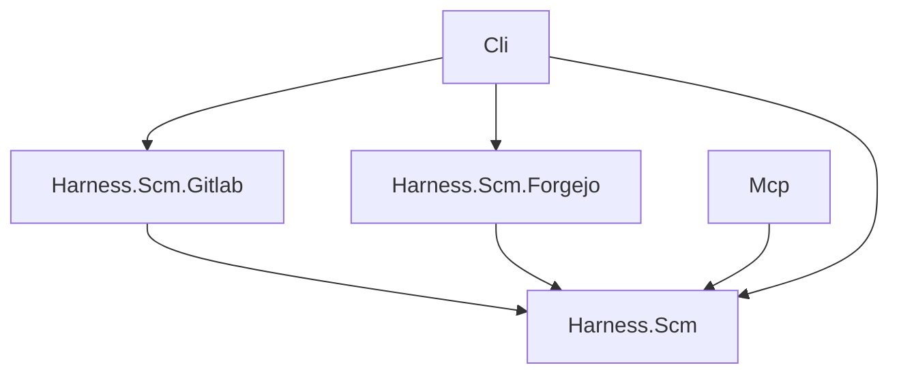

# SCM integration

Source: [`src/Harness.Scm`](../../src/Harness.Scm).
Harness.Scm is a provider-neutral library for SCM servers (GitLab, Forgejo):
the contracts that providers implement, the shared models and errors, and the
matcher that maps a repository's git remote URL to a configured SCM. It has no
project references, so any harness assembly allowed to reference it can use SCM
features without pulling in storage, MCP or the web stack.

| Assembly | Responsibility | Project dependencies |
| --- | --- | --- |
| Harness.Scm | Contracts, models, errors, remote URL parsing and matching | None |
| Harness.Scm.Gitlab | GitLab REST API v4 provider | Harness.Scm |
| Harness.Scm.Forgejo | Forgejo REST API v1 provider | Harness.Scm |

Mcp may reference Harness.Scm (its tools take the contracts); Cli composes the
providers. `Directory.Build.targets` enforces this graph like the rest of
harness's assemblies.

## Contracts

`IScmProvider` is one SCM implementation, keyed by `ScmKind` (`gitlab`,
`forgejo`). `Connect(ScmConnection)` returns an `IScmClient` bound to one
server and token. `ScmProviderRegistry` holds the providers and connects
through the one of a connection's kind. A client offers:

- `TestConnectionAsync`: the server's version and the token's user, or a
  categorised failure; it never throws for a failed check;
- projects: list (search, visibility) and get one;
- merge requests: list by state (opened, merged, closed), details, comments,
  a general comment, a comment on one diff line (path, line, `new` or `old`
  side), the diff within a byte budget, title, description and approval.

A project is named by the full path the API uses (`group/sub/repo` on GitLab,
`owner/repo` on Forgejo); a merge request by its project-scoped number (GitLab
iid, Forgejo pull request index). Models (`ScmProject`, `MergeRequest`,
`ScmComment` with an optional `ScmDiffPosition`, `ScmFileDiff`,
`ScmMergeRequestDiff`, `ScmApproval`) are plain records; a provider maps its
server's JSON into them with source-generated System.Text.Json metadata, so the
libraries stay trimmable and Native AOT clean. `ScmLimits` bounds every call:
timeout, pages followed, page size and the longest Retry-After waited once.

## Errors and tokens

Failures throw `ScmException` with an `ScmErrorKind`: `unreachable`, `tls`,
`unauthorized`, `forbidden`, `not_found`, `wrong_server` (the URL does not
answer like the configured type), `invalid` (the server refused the content,
e.g. a line outside the diff), `rate_limited` and `server`. `ScmErrors` maps
HTTP statuses and transport failures to kinds and gives each kind a fix hint.

Only token authentication is supported. `ScmEndpoint` (name, kind, base URL)
is what may be shown and matched; `ScmConnection` adds the token and prints
it only masked (`ScmTokens.Mask`: `****` and the last four characters).
Exception messages never contain the token; providers pass any server text
through `ScmErrors.Redact` before using it.

## Matching a remote

`ScmRemoteUrl.TryParse` accepts `https://` and `http://`, `ssh://[user@]host[:port]/path`
(also `git+ssh://`), `git://` and scp-like `[user@]host:path` remotes, with or
without `.git` and a trailing slash. Windows drive paths (`C:\repo`), other
local paths and `file://` are not remotes.

`ScmMatcher.Match(endpoints, remote)` chooses the configured SCM for a remote:

1. the host must equal the SCM's base URL host, ignoring case;
2. an http(s) remote must use the same port (default ports count as equal);
   ssh and git remotes may use any port and user, since SSH is served apart from
   the web server;
3. the SCM's base path (an instance under `https://host/gitlab`) must prefix an
   http(s) remote's path; an ssh remote may include it or not, as GitLab's SSH
   clone URLs leave the relative URL root out;
4. the rest of the path is the project: at least `namespace/repo` on GitLab
   (nested groups allowed), exactly `owner/repo` on Forgejo;
5. of the SCMs that match, the one with the longest base path wins; equally
   long matches are reported as ambiguous instead of guessed.

A result without a match carries the reason (the remote's host and path and the
SCMs configured), so callers can tell the user what to change.
