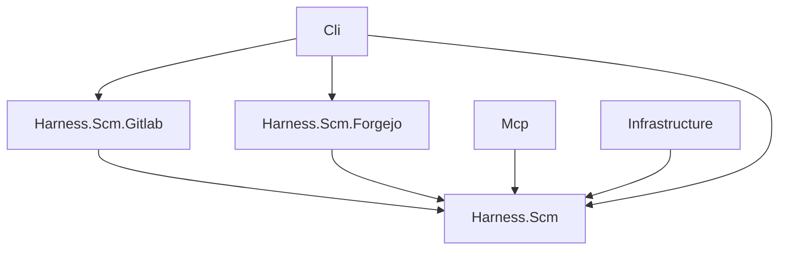

# SCM integration

Source: [`src/Harness.Scm`](../../src/Harness.Scm).
Harness.Scm is a provider-neutral library for SCM servers (GitLab, Forgejo):
the contracts that providers implement, the shared models and errors, and the
matcher that maps a repository's git remote URL to a configured SCM. It has no
project references, so any harness assembly allowed to reference it can use SCM
features without pulling in storage, MCP or the web stack.

| Assembly | Responsibility | Project dependencies |
| --- | --- | --- |
| Harness.Scm | Contracts, models, errors, remote URL parsing and matching | None |
| Harness.Scm.Gitlab | GitLab REST API v4 provider | Harness.Scm |
| Harness.Scm.Forgejo | Forgejo REST API v1 provider | Harness.Scm |

Mcp may reference Harness.Scm (its tools take the contracts), Infrastructure
implements its configuration store (so Agents, through Infrastructure, sees it
too), and Cli composes the providers. `Directory.Build.targets` enforces this graph like the rest of
harness's assemblies.

## Contracts

`IScmProvider` is one SCM implementation, keyed by `ScmKind` (`gitlab`,
`forgejo`). `Connect(ScmConnection)` returns an `IScmClient` bound to one
server and token. `ScmProviderRegistry` holds the providers and connects
through the one of a connection's kind. A client offers:

- `TestConnectionAsync`: the server's version and the token's user, or a
  categorised failure; it never throws for a failed check;
- projects: list (search, visibility) and get one;
- merge requests: list by state (opened, merged, closed), details, comments,
  a general comment, a comment on one diff line (path, line, `new` or `old`
  side), the diff within a byte budget, title, description and approval.

A project is named by the full path the API uses (`group/sub/repo` on GitLab,
`owner/repo` on Forgejo); a merge request by its project-scoped number (GitLab
iid, Forgejo pull request index). Models (`ScmProject`, `MergeRequest`,
`ScmComment` with an optional `ScmDiffPosition`, `ScmFileDiff`,
`ScmMergeRequestDiff`, `ScmApproval`) are plain records; a provider maps its
server's JSON into them with source-generated System.Text.Json metadata, so the
libraries stay trimmable and Native AOT clean. `ScmLimits` bounds every call:
timeout, pages followed, page size and the longest Retry-After waited once.

## Errors and tokens

Failures throw `ScmException` with an `ScmErrorKind`: `unreachable`, `tls`,
`unauthorized`, `forbidden`, `not_found`, `wrong_server` (the URL does not
answer like the configured type), `invalid` (the server refused the content,
e.g. a line outside the diff), `rate_limited` and `server`. `ScmErrors` maps
HTTP statuses and transport failures to kinds and gives each kind a fix hint.

Only token authentication is supported. `ScmEndpoint` (name, kind, base URL)
is what may be shown and matched; `ScmConnection` adds the token and prints
it only masked (`ScmTokens.Mask`: `****` and the last four characters).
Exception messages never contain the token; providers pass any server text
through `ScmErrors.Redact` before using it.

## Matching a remote

`ScmRemoteUrl.TryParse` accepts `https://` and `http://`, `ssh://[user@]host[:port]/path`
(also `git+ssh://`), `git://` and scp-like `[user@]host:path` remotes, with or
without `.git` and a trailing slash. Windows drive paths (`C:\repo`), other
local paths and `file://` are not remotes.

`ScmMatcher.Match(endpoints, remote)` chooses the configured SCM for a remote:

1. the host must equal the SCM's base URL host, ignoring case;
2. an http(s) remote must use the same port (default ports count as equal);
   ssh and git remotes may use any port and user, since SSH is served apart from
   the web server;
3. the SCM's base path (an instance under `https://host/gitlab`) must prefix an
   http(s) remote's path; an ssh remote may include it or not, as GitLab's SSH
   clone URLs leave the relative URL root out;
4. the rest of the path is the project: at least `namespace/repo` on GitLab
   (nested groups allowed), exactly `owner/repo` on Forgejo;
5. of the SCMs that match, the one with the longest base path wins; equally
   long matches are reported as ambiguous instead of guessed.

A result without a match carries the reason (the remote's host and path and the
SCMs configured), so callers can tell the user what to change.

## Machine configuration

SCM connections are machine-wide: `IScmConfiguration` (in Harness.Scm) lists,
finds, adds, updates and removes them, and `ScmConfigurationFile`
(Infrastructure, `src/Harness.Infrastructure/Scm`) implements it over
`scm.toml` beside the global `config.toml`, one `[scm.<name>]` table per SCM
with `type`, `url` and `token` or `token_env`. `ScmEntryRules` validates
names (1-64 letters, digits, `-`, `_`, `.`; unique ignoring case), types,
base URLs, tokens and variable names, and failures throw
`ScmConfigurationException`.

Entries come back as `ScmEntry`: endpoint, token source and the token masked.
Only `Resolve(name)` returns an `ScmConnection` with the token, read from the
file or from the named environment variable at that moment. Writes take the
machine-file lock (`scm.toml.lock`), write a temporary file restricted to the
owner before any token is in it (an owner-only, non-inherited ACL on Windows,
mode 600 elsewhere), and replace the file atomically, so a file whose
permissions were widened is tightened by the next write. `Inspect()` reports
whether the file exists, parses and is owner-only, for doctor.

`harness scm list|add|set|remove` (`src/Harness.Cli/Scm`) drives the store;
`--token-stdin` reads the token from standard input so it stays out of shell
history, and output shows tokens only masked.

## Shared HTTP plumbing

`ScmHttpClient` (Harness.Scm) is what both providers call through: relative
API paths against the connection's base URL (so instances under a sub-path
work), the provider's token header on each request, a per-request timeout
(`ScmLimits.Timeout`, reported as `unreachable`), caller cancellation passed
through as `OperationCanceledException`, one retry after HTTP 429 when the
server's `Retry-After` is within `ScmLimits.MaxRetryWait`, and paging that
follows full pages (and GitLab's `X-Next-Page`) up to `ScmLimits.MaxPages`.
JSON is read with each provider's source-generated `JsonSerializerContext`;
an answer that is not the expected JSON (an HTML login page, a proxy) is
`wrong_server`. A failed status becomes an `ScmException` naming the method,
path and status with the server's `message`, the token removed.
`SharedHandler` pools connections for the whole process; tests pass a fake
`HttpMessageHandler` instead.

`UnifiedDiff.Locate` finds a line in a file's hunks: an added line has only a
new number, a removed one only an old number, and a context line both, which
GitLab needs for a comment on an unchanged line. `UnifiedDiff.SplitFiles`
splits a whole `git diff` into files. `ScmDiffBudget.Apply` keeps a merge
request's diff within the caller's byte budget without dropping files: a file
that does not fit keeps what fits, cut at a line end, and is marked truncated;
once the budget is spent the remaining files keep only their paths, marked
truncated and counted as omitted.

## GitLab

`GitlabProvider` (`src/Harness.Scm.Gitlab`) speaks REST API v4 with the token
in the `PRIVATE-TOKEN` header. A project is addressed by its URL-encoded full
path (`api/v4/projects/group%2Fsub%2Frepo`), a merge request by its iid.

| Operation | GitLab call |
| --- | --- |
| Test connection | `GET /version` (a missing API is `wrong_server`), then `GET /user` |
| Projects | `GET /projects?membership=true&visibility=&search=`, paged |
| Merge requests | `GET /projects/:id/merge_requests?state=opened\|merged\|closed`, paged |
| Details | `GET .../merge_requests/:iid` and `.../approvals` (left unknown when the token cannot read it) |
| Comments | `GET .../discussions`, flattened oldest first; system notes are marked, diff notes keep their position and thread |
| General comment | `POST .../notes` |
| Diff comment | `POST .../discussions` with a `text` position from the merge request's `diff_refs` (base, start, head SHA), both paths of the file, and the old and/or new line `UnifiedDiff.Locate` finds; a file or line outside the diff is refused before posting |
| Diff | `GET .../diffs` (GitLab 15.7+), else `GET .../changes`; `too_large` files are marked truncated |
| Title, description | `PUT .../merge_requests/:iid` |
| Approve | `POST .../approve` |

## Forgejo

`ForgejoProvider` (`src/Harness.Scm.Forgejo`) speaks REST API v1 (also served
by Gitea) with the token in `Authorization: token <t>`. A project is
`owner/repo`; a merge request is a pull request, addressed by its index.

| Operation | Forgejo call |
| --- | --- |
| Test connection | `GET /version` (a missing API is `wrong_server`, which is what a GitLab URL answers), then `GET /user` |
| Projects | `GET /repos/search?q=&private=true`, paged by `page`/`limit`; without a search also `GET /user/repos`, merged by id |
| Merge requests | `GET /repos/{o}/{r}/pulls?state=open\|closed`, paged |
| Details | `GET .../pulls/{i}` and `.../pulls/{i}/reviews` |
| Comments | `GET .../issues/{i}/comments`, review bodies, and `GET .../pulls/{i}/reviews/{id}/comments` for reviews with inline comments |
| General comment | `POST .../issues/{i}/comments` |
| Diff comment | `POST .../pulls/{i}/reviews` with event `COMMENT`, the head commit and one comment with `path` and `new_position` or `old_position` |
| Diff | `GET .../pulls/{i}.diff`, split per file |
| Title, description | `PATCH .../pulls/{i}` |
| Approve | `POST .../pulls/{i}/reviews` with event `APPROVED` on the head commit |

Where it differs from GitLab:

- **States**: Forgejo knows only open and closed. `merged` asks for closed
  pull requests and keeps those with `merged: true`; `closed` keeps the others.
- **Visibility**: a repository is private, or public; one of a `limited`
  (signed-in users only) owner has `internal: true`, which harness reports as
  `internal`. The API cannot filter by it, so projects are filtered after
  they are read.
- **Approvals**: Forgejo has no approval rules API, so `Approved` stays unknown
  (null); `ApprovedBy` lists the users whose latest approving or
  change-requesting review approves and is neither dismissed nor stale (made
  stale by later commits). Approving creates such a review.
- **Comments**: a review's body is listed as a general comment (id
  `review-<id>`, prefixed with its state); its inline comments are diff
  comments, with the review as their thread. `position` is a line of the new
  file and `original_position` one of the old file. There are no system notes.
- **Diffs**: read from the `.diff` patch, so binary, renamed, added and deleted
  files are recognised from its headers; the patch is cut at 20 MiB before the
  caller's byte budget applies.
- **Drafts**: a pull request is a draft when the server says so or its title
  starts with `WIP:` or `[WIP]`.
