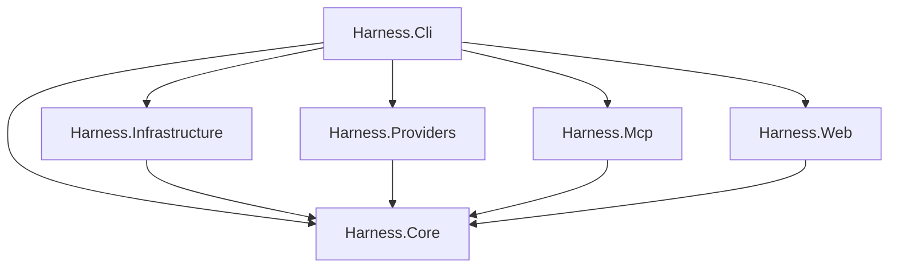

# Solution boundaries and package validation

TASK-0003 / PORT-003 proposes six .NET 10 assemblies, with C# 14 and central
package versions. This is a package and architecture spike; the runnable product
scaffold belongs to PORT-004 (TASK-0005). The [baseline](README.md) and
[compatibility fixtures](fixture-harness.md) remain the authority for behavior.
Library defaults do not replace those contracts.

The six-project scaffold, CLI and root build configuration are now implemented by
[TASK-0005 / PORT-004](bootstrap.md).

## Assembly boundaries

| Project under `src` | Responsibility | Allowed project references |
| --- | --- | --- |
| `Harness.Core` | Feature modules, domain rules, use cases, storage/provider ports and transport-independent request/result models | None |
| `Harness.Infrastructure` | SQLite repositories and migrations, filesystem/state/config handling, Git and process execution implementations | Core |
| `Harness.Providers` | Provider discovery, capability negotiation, MCP client sessions, resilience and response normalization | Core |
| `Harness.Mcp` | Public MCP tools, explicit wire schemas, validation and result envelopes | Core |
| `Harness.Web` | ASP.NET Core endpoints, UI assets, streaming/live updates and per-section loading | Core |
| `Harness.Cli` | Spectre commands, exit/output policy, host lifecycle and dependency injection composition root | Core, Infrastructure, Providers, Mcp, Web |

References point toward Core; adapters use Core ports and are connected by Cli.
For example, Providers receives a process launcher through a Core interface,
rather than referencing Infrastructure. Core must not expose SQLite connections,
Spectre commands, MCP SDK DTOs or ASP.NET types. Keep ports beside the use cases
that need them, rather than making another abstractions assembly.



`Directory.Build.targets` enforces this graph for these six exact project names
before project-reference preparation and restore traversal. Any other project
reference, including a self-reference, is rejected. Tests and future companion
hosts can reference the assemblies they exercise. The six production assemblies
cannot reference those hosts or tests. The allowed edges form a DAG; adding an
edge requires changing and reviewing the policy. This checks project references,
not namespace layering inside an assembly or manually added DLL references.

Use feature folders inside Core for memory, tasks, projects/workspaces, retrieval,
sync, architecture and observability. Preserve the [scope map](scope-map.md) by
mapping its 45 Go subsystems into these modules, rather than creating 45 projects.
Optional graphify/collect/share hosts can be introduced by their existing tasks
when their packaging requirements become concrete. Claude Code and Codex client
configuration belongs behind integration-specific adapters in Infrastructure;
neither client should dictate Core models. Roslyn-based C# intelligence remains
a later provider concern. TypeScript needs overview and repetition detection,
not an equivalent compiler analyzer.

Keep product projects in `src`, tests in `test`, benchmarks in `benchmarks`, and
documentation in `doc`. Start with one Core test project and one integration test
project covering storage, providers and transports; add projects when independent
execution or dependencies justify them. The temporary spike is under ignored
`artifacts/package-spike`, not a committed product or test scaffold.

## CPM choices

Versions below were checked against NuGet package metadata and actual restored
assemblies on 2026-10-20. [Validation receipts](inventory/package-validation.json)
record the resolved dependency graph, declared licenses and artifact hashes.

| Dependency | Choice and ownership | License / deployment |
| --- | --- | --- |
| Microsoft.Extensions packages, 10.0.13 | Keep existing pins; Hosting/DI/options/logging at composition boundaries, abstractions only where used | MIT; managed |
| Spectre.Console and Spectre.Console.Cli, 0.57.2 | Align Cli from 0.55.0; use in Harness.Cli only | MIT; Console.Ansi and Bcl.TimeProvider transitive dependencies |
| ModelContextProtocol.Core, 2.2.0 | Keep for protocol/client types in Providers/Mcp when directly used | Apache-2.0; managed |
| ModelContextProtocol, 2.2.0 | Add high-level server/hosting package for Mcp | Apache-2.0; depends on Core exactly 2.2.0 and Microsoft.Extensions |
| Microsoft.Data.Sqlite, 10.0.13 | Add in Infrastructure; direct parameterized SQL and original ordered migrations | MIT; SQLitePCLRaw 2.1.13 native bundle described below |
| Tomlyn, 2.10.1 | Add for TOML state/config edits in Infrastructure | BSD-2-Clause; managed; System.Text.Json/Immutable dependencies |
| YamlDotNet, 18.1.0 | Add for backlog YAML import/export in Infrastructure | MIT; managed; no package dependencies in the selected target |
| xunit.v3, 4.0.0 | Keep for all new .NET tests, native MTP v2 runner | Apache-2.0; test executable, not a product dependency |
| Microsoft.Testing.Extensions.TrxReport, 2.5.0 | Keep the existing automatic test-project reference | MIT; resolves Microsoft.Testing.Platform 2.5.0 |

CPM entries are a version catalog, not automatic package references. Add references
only to consuming projects. Existing unused pins, including xUnit v2, the Visual
Studio runner, reactive packages, Roslyn-related candidates and extra MCP
transports, remain dormant. Do not use the old `xunit`, `xunit.runner.visualstudio`
or `Microsoft.NET.Test.Sdk` entries in the new MTP test projects. Removing unrelated
catalog entries is outside this spike.

Spectre 0.55.0 requires Console >= 0.55.0, so the previous combination was not
proven incompatible. Aligning both to 0.57.2 gives one tested version pair. Configure
`UseStrictParsing()`: the probe otherwise accepted an unknown flag. With strict
parsing, missing required arguments returned 1 and an unknown flag returned -1.
Map these deliberately to the frozen CLI contract, and control help, aliases,
JSON/plain output and redirected color behavior explicitly. Do not inherit default
error text as the compatibility specification.

Use ASP.NET Core through `FrameworkReference Include="Microsoft.AspNetCore.App"`
in Web, rather than adding older standalone ASP.NET packages. Use the shared
framework's Hosting/DI/logging where available: the combined Web/test probe emitted
NU1510 for an explicit Hosting reference, while the standalone MCP host validated
the actual Hosting package. ModelContextProtocol.AspNetCore is not needed for the
baseline stdio MCP server; retain its existing catalog pin for a future transport
requirement. The SDK's [transport APIs](https://csharp.sdk.modelcontextprotocol.io/v2/concepts/transports/transports.html)
provide `AddMcpServer().WithStdioServerTransport()` and `StdioClientTransport`.
Keep protocol stdout free of logs; send server logs to stderr. The client owns its
connected session lifecycle; `StdioClientTransport` itself is not asynchronously
disposable. Explicit schema/result adapters and the existing Go fixture comparison
are still required; an echo round trip does not prove all 30 tools compatible.

Use external `git` with argument lists and the frozen command/error semantics;
do not add LibGit2Sharp or another native Git dependency. Use built-in
`System.Threading.Channels` for bounded queues and `System.Text.Json` for JSON.
Prefer `ILogger` and built-in diagnostics until measured needs justify additional
telemetry packages. Core need not reference a package merely because CPM lists it.

Direct SQL preserves the existing schema and transaction behavior. Dapper is an
optional later mapping convenience, not a required dependency. Defer EF Core,
reactive/event-bus frameworks, eager in-process Roslyn indexing and mandatory
NativeAOT. There is no demonstrated requirement for their startup, deployment or
runtime cost in the initial port.

### Test runner requirement

The package named `xunit.v3` at version 4.0.0 is still the xUnit v3 API. Its
metapackage selects `xunit.v3.mtp-v2`; it does not require a second v2 framework or
VSTest runner. Use `OutputType=Exe`, `IsTestProject=true` and
`UseMicrosoftTestingPlatformRunner=true`. The existing target supplies TRX reporting.
This matches [xUnit's MTP guidance](https://xunit.net/docs/getting-started/v3/microsoft-testing-platform).

The bootstrap task must add native MTP selection alongside its .NET 10 SDK pin:

```json
{
  "sdk": { "version": "10.0.402", "allowPrerelease": false },
  "test": { "runner": "Microsoft.Testing.Platform" }
}
```

10.0.402 is the stable SDK used for this spike, not a NuGet runtime package version.
The root property `Net100SdkVersion=10.0.13` currently represents the package train;
do not mistake it for an SDK pin. Without a pin this machine selected a .NET 11
release candidate. Pinning the product SDK remains bootstrap work.

The old `TestingPlatformDotnetTestSupport=true` property alone failed on .NET 10:
the resolved MTP 2.x MSBuild integration rejects the legacy VSTest path. Native
MTP mode passed with `dotnet test --project ... --report-trx`; no extra `--` is
needed before reporter arguments. See [Microsoft's runner selection guidance](https://learn.microsoft.com/en-us/dotnet/core/testing/unit-testing-with-dotnet-test).
The resolved MTP.MSBuild package is 2.3.3 and Platform/reporting are 2.5.0 through
the current TRX dependency; this dependency combination passed. IDE discovery and
CI integration remain bootstrap validation, rather than claims of this spike.

### Configuration and storage details

Tomlyn v2 uses `Tomlyn.Parsing.SyntaxParser.Parse(text)`, `HasErrors`, `Diagnostics`
and `ToString()` for syntax and trivia preservation. A CRLF/comment-preserving
round trip passed. Do not use old `Toml.Parse` examples. Typed parsing uses
`TomlSerializer.Deserialize<T>`. Valid syntax accepts arbitrary key names; schema
validation and ownership-aware edits remain application responsibilities.
`TomlSerializerOptions` has no `UnmappedMemberHandling` setting in this version.
Validate allowed keys before mapping strict harness configuration, and patch the
syntax tree when client configuration must retain unrelated entries/comments.
See [Tomlyn's low-level API](https://xoofx.github.io/Tomlyn/docs/low-level/).

For YAML, use `DeserializerBuilder.WithDuplicateKeyChecking()` and a bounded
`WithMaximumRecursion(...)`. Do not opt into `IgnoreUnmatchedProperties()` for a
strict schema. Unknown keys, duplicate fields and malformed input were rejected
by the probe. Set naming conventions explicitly and preserve the frozen export
ordering/ownership rules; generic reserialization does not promise comment fidelity.

Microsoft.Data.Sqlite opened all five historical fixture databases read-only,
passed integrity checks, executed all 19 original migrations on a fresh database,
used an immediate transaction with parameters, and backed up Unicode data. This
proves basic native/API compatibility; upgrade/recovery/locking parity is the
storage task. SQLite ADO.NET async methods execute synchronously, so use short SQL
operations, WAL and bounded write coordination rather than expecting asynchronous
I/O to improve throughput. Long maintenance operations need dedicated background
work and cancellation boundaries; do not wrap every hot query in `Task.Run`.
See [Microsoft's SQLite async limitations](https://learn.microsoft.com/en-us/dotnet/standard/data/sqlite/async).

### Deployment and licenses

Microsoft.Data.Sqlite is a metapackage. The restore selected
Microsoft.Data.Sqlite.Core 10.0.13 and SQLitePCLRaw.bundle_e_sqlite3/core/provider/
lib.e_sqlite3 2.1.13. SQLitePCLRaw packages declare Apache-2.0; the underlying
[SQLite engine is public domain](https://www.sqlite.org/copyright.html). Retain
third-party notices for the wrapper and other shipped dependencies; the receipt
contains the actual restored package license declarations, not a legal audit or
release SBOM.

The native bundle contains win-x64, linux-x64, linux-arm64, osx-x64 and osx-arm64
assets, matching the existing RID list. Only win-x64 was executed. Linux/macOS
loader behavior, file locks, executable permissions, Git availability and both
ARM64 targets still need native CI smoke tests. Musl is a separate RID; do not
claim Alpine support from a linux-x64 asset. Choose framework-dependent or
self-contained publishing per release; framework-dependent Cli includes Web and
therefore needs the ASP.NET Core runtime as well as .NET. Single-file publishing
must handle native SQLite extraction explicitly. Do not enable trimming/AOT until
reflection-based command/tool discovery and serializers are validated.

## Performance and bootstrap handoff

Keep MCP handlers and repeatedly executed sync/live-update paths small: reuse
provider sessions, avoid rescanning the repository or launching Git per trivial
read, and use bounded queues with backpressure. Cache only with explicit state
invalidation. Keep transport latency distinct from optional code-intelligence
provider startup and compiler indexing. Measure against the pinned fixtures before
adding abstractions that allocate or serialize on every request.

Web sections must fetch independently, show their own loading state, and tolerate
slow optional providers without delaying the rest of the page. Keep database
maintenance, full architecture scans and history aggregation off the response
path. No performance numbers are claimed by this correctness spike.

TASK-0005 should create the six projects and solution, apply the stable SDK/MTP
configuration, keep analyzers enabled for committed C#, and verify CLI/Web/MCP
startup with the dependency guard active. Review the existing `PlatformTargets`
spelling/x64-versus-ARM64 policy and volatile build metadata there. These shared
build-policy changes were not needed to establish package compatibility.

## Validation evidence

The ignored probe imports the real root props, targets and CPM. It overrides the
multi-RID list to empty, uses one net10.0 target, and disables analyzers/code-style
enforcement for throwaway sources. It does not validate production analyzer
compliance, release publishing, AOT, or non-Windows execution. The isolated NuGet
config maps all packages to nuget.org; inherited machine source mapping initially
rejected them. No user/global NuGet settings were changed.

Successful commands from `artifacts/package-spike` (the environment sets
`NUGET_PACKAGES`/`DOTNET_CLI_HOME` locally, opts out of CLI/MTP telemetry, and sets
`HARNESS_SPIKE_ROOT` to the repository root):

```powershell
dotnet restore Tests/Tests.csproj --configfile NuGet.Config -bl:restore-03.binlog
dotnet build Tests/Tests.csproj --no-restore -bl:build-03.binlog
dotnet test --project Tests/Tests.csproj --no-restore -bl:test-06.binlog --report-trx --report-trx-filename package-spike-verified.trx --results-directory C:/repos/personal/ai-harness-cs/artifacts/package-spike/results
./check-graph.ps1
```

The named logs above are receipts; choose fresh binlog names for a rerun. The last
test command also rebuilt the final probe after discovering Spectre's parsing
defaults. Seven tests passed: SQLite fixtures/migrations/backup, Tomlyn
syntax/trivia, strict YAML, strict CLI parsing, Hosting/Channels/JSON, Kestrel HTTP,
and MCP stdio list/call with Unicode. The graph matrix passed 48 checks (15
allowed, 33 rejected); two more checks verified guard rejection through the actual
SDK's build and restore entry points. [Machine-readable receipts](inventory/package-validation.json)
retain test names/results, commands, resolved versions/licenses, source hashes and
successful binlog hashes. Temporary source and binlogs remain locally available
under `artifacts/package-spike`; subsequent tasks own durable product tests.
